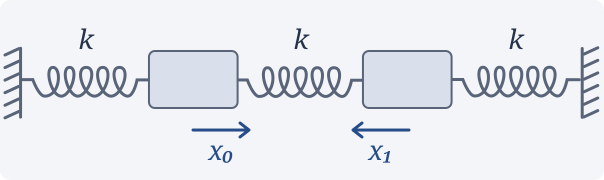

<!-- Written by tools/markdown_edition.py from paper.md, links.json and the Lean. Edit those, then run it again. -->

# The minimum of the coupled spring potential

The coupled spring potential U(x₀, x₁) = x₀² + x₀x₁ + x₁² has a unique
global minimum at the origin. To see why, think of two masses joined by
springs. Moving either mass stores energy in its wall spring. In
PhyslibAlpha, Bjørn Kjos-Hanssen proves a local minimum with a general
second-derivative test. The spring calculation also supplies the uniform
Hessian bound that drives that test.

<details>
<summary><b>Lean</b> · The coupled spring potential · <code>couplingPotential</code></summary>

```lean
/-- The potential energy of a pair of coupled springs. -/
noncomputable def couplingPotential (x : EuclideanSpace ℝ (Fin 2)) : ℝ :=
  (x 0) ^ 2 + x 0 * x 1 + (x 1) ^ 2
```

Copied whole from [CoupledSpringPotential.lean, lines 56–57][couplingPotential] in Physlib at be0a9ee.

</details>

[Read it with the Lean beside it](https://wcook04.github.io/proof-reader/#/coupled-spring) · [Lean source](https://github.com/leanprover-community/physlib/tree/be0a9eef7dac78da524bfbde91c812340b194610)

## 1. Where the squares come from

Take two masses on a line between fixed walls. A spring connects each mass
to its wall, and a third connects the masses. All three ideal springs have
stiffness k > 0 and are at their natural lengths at the reference positions.
Measure x₀ and x₁ from those positions, with each positive direction
pointing inward.



Moving the left mass inward by x₀ lengthens its wall spring by x₀.
The right wall spring lengthens by x₁. Both inward motions shorten the
middle spring, so its change in length is −(x₀ + x₁). Each spring stores
½k times its squared change in length. Their total is kU(x), where

U(x) = ½(x₀² + x₁² + (x₀ + x₁)²).

For displacements in metres, U has units of square metres and kU is
in joules. Multiplication by k > 0 preserves minima. The wall springs alone
give U(x) ≥ ½‖x‖², so the origin is the only place
where all the stored energy can vanish.

**Supplementary result.** For every nonzero x ∈ ℝ², U(x) > U(0).
Both sides are zero at x = 0. A separate Lean proof written for this page
starts by completing the square.

<details>
<summary><b>Lean proof</b> · Unique global minimum · <code>couplingPotential_origin_lt</code></summary>

```lean
/-- At every point other than the origin the coupled spring potential is larger than at the
origin. -/
theorem couplingPotential_origin_lt (x : EuclideanSpace ℝ (Fin 2)) (hx : x ≠ 0) :
    couplingPotential (!₂[0, 0] : EuclideanSpace ℝ (Fin 2)) < couplingPotential x := by
  have h0 : couplingPotential (!₂[0, 0] : EuclideanSpace ℝ (Fin 2)) = 0 := by
    first
      | simp [couplingPotential]
      | norm_num [couplingPotential]
  rw [h0]
  exact couplingPotential_pos x hx
```

Lean accepted this supplementary proof, written with AI for this page. [checks/StrictMinimum.lean, lines 32–41][couplingPotential_origin_lt].

</details>

U(x) = (x₀ + ½x₁)² + ¾x₁².

<details>
<summary><b>Lean proof</b> · Completing the square · <code>couplingPotential_eq_sq_add_sq</code></summary>

```lean
/-- The coupled spring potential equals `(x₀ + x₁/2)² + (3/4) x₁²` at every point. -/
theorem couplingPotential_eq_sq_add_sq (x : EuclideanSpace ℝ (Fin 2)) :
    couplingPotential x = (x 0 + x 1 / 2) ^ 2 + 3 / 4 * (x 1) ^ 2 := by
  unfold couplingPotential
  ring
```

Lean accepted this supplementary proof, written with AI for this page. [checks/GlobalMinimum.lean, lines 3–7][couplingPotential_eq_sq_add_sq].

</details>

If the sum is zero, the second term forces x₁ = 0. The first then forces
x₀ = 0. The three-square form identifies the spring that stores energy.
The two-square form rules out equality one coordinate at a time.

<details>
<summary><b>Lean proof</b> · Why equality forces the origin · <code>couplingPotential_pos</code></summary>

```lean
/-- Away from the origin the coupled spring potential is strictly positive. -/
theorem couplingPotential_pos (x : EuclideanSpace ℝ (Fin 2)) (hx : x ≠ 0) :
    0 < couplingPotential x := by
  have hsq : couplingPotential x = (x 0 + x 1 / 2) ^ 2 + 3 / 4 * (x 1) ^ 2 := by
    unfold couplingPotential
    ring
  rw [hsq]
  by_contra h
  have hs : 0 ≤ (x 0 + x 1 / 2) ^ 2 := sq_nonneg _
  have ht : 0 ≤ (x 1) ^ 2 := sq_nonneg _
  have h1 : x 1 = 0 := by
    have h1sq : (x 1) ^ 2 = 0 := by linarith
    exact (pow_eq_zero_iff two_ne_zero).mp h1sq
  have h0 : x 0 = 0 := by
    have h0sq : (x 0 + x 1 / 2) ^ 2 = 0 := by linarith
    have h0lin : x 0 + x 1 / 2 = 0 := (pow_eq_zero_iff two_ne_zero).mp h0sq
    linarith
  apply hx
  ext i
  fin_cases i
  · first
      | simpa using h0
      | (simp; exact h0)
      | exact h0
  · first
      | simpa using h1
      | (simp; exact h1)
      | exact h1
```

Lean accepted this supplementary proof, written with AI for this page. [checks/StrictMinimum.lean, lines 3–30][couplingPotential_pos].

</details>

## 2. What Physlib proves

**Physlib theorem.** The coupled spring potential U has a local minimum
at the origin. In symbols, U(0) ≤ U(x) for all x in some neighbourhood
of 0.

<details>
<summary><b>Lean</b> · Local minimum at the origin · <code>coupled_spring_potential</code></summary>

```lean
lemma coupled_spring_potential :
    let U := fun x : EuclideanSpace ℝ (Fin 2) => (x 0)^2 + x 0 * x 1 + (x 1)^2
    IsLocalMin U {
        ofLp := ![0,0]
    } := by
```

Statement copied from [CoupledSpringPotential.lean, lines 153–160][coupled_spring_potential] in Physlib at be0a9ee; the proof is at the link.

**Comparison with the page, made by AI and not reviewed: same statement.** The Lean theorem writes out the polynomial in a let expression and states IsLocalMin at the zero vector. That means U(0) ≤ U(x) on a neighbourhood. The global inequality has its own passage and proof.

</details>

Kjos-Hanssen applies the following test from the companion Lean file.
Let f be real-valued on a finite-dimensional real inner product space.
If f is analytic at a, its gradient vanishes at a, and
D²f(a)[h, h] > 0 for every h ≠ 0, then f has a local minimum at a.

<details>
<summary><b>Lean</b> · The second-derivative test · <code>second_derivative_test_analyticAt</code></summary>

```lean
/--
A more convenient form of the second partial derivative test: it suffices that `f`
is analytic at `x₀` (so that an explicit power series need not be produced by hand).
-/
theorem second_derivative_test_analyticAt {V : Type*} [NormedAddCommGroup V]
    [InnerProductSpace ℝ V] [FiniteDimensional ℝ V] {f : V → ℝ} {x₀ : V}
    (h₀ : gradient f x₀ = 0) (han : AnalyticAt ℝ f x₀)
    (hf : (iteratedFDerivQuadraticMap f x₀).PosDef) : IsLocalMin f x₀ := by
```

Statement copied from [PartialDerivativeTest.lean, lines 600–606][second_derivative_test_analyticAt] in Physlib at be0a9ee; the proof is at the link.

**Comparison with the page, made by AI and not reviewed: same statement.** Lean takes a finite-dimensional real inner product space, analyticity and zero gradient at the point, and PosDef of the map h ↦ D²f(a)[h,h]. Its conclusion is IsLocalMin, with a weak inequality on a neighbourhood.

</details>

The hypotheses can all be read off from U. It is a polynomial, so it is
analytic at every point. Expanding U(x + h) gives a linear term in h and
the remainder U(h). The bound 0 ≤ U(h) ≤ (3/2)‖h‖²
follows from the three squares and (h₀ + h₁)² ≤ 2‖h‖².
Thus U(h)/‖h‖ tends to zero as h tends to zero through
nonzero vectors. The linear term is the derivative.

<details>
<summary><b>Lean</b> · The potential is analytic · <code>couplingPotential_analyticAt</code></summary>

```lean
/-
The coupling potential is analytic everywhere (it is a polynomial).
-/
lemma couplingPotential_analyticAt (z : EuclideanSpace ℝ (Fin 2)) :
    AnalyticAt ℝ couplingPotential z := by
```

Statement copied from [CoupledSpringPotential.lean, lines 68–75][couplingPotential_analyticAt] in Physlib at be0a9ee; the proof is at the link.

**Comparison with the page, made by AI and not reviewed: same statement.** The point z is arbitrary in EuclideanSpace ℝ (Fin 2). Lean proves analyticity at each such point.

</details>

DU(x)[h] = (2x₀ + x₁)h₀ + (x₀ + 2x₁)h₁.

<details>
<summary><b>Lean</b> · Derivative of the potential · <code>couplingPotential_hasFDerivAt</code></summary>

```lean
/-
The derivative of the coupling potential at any point, as an explicit
linear functional.
-/
lemma couplingPotential_hasFDerivAt (x : EuclideanSpace ℝ (Fin 2)) :
    HasFDerivAt couplingPotential
      ((2 * x 0 + x 1) • (EuclideanSpace.proj (𝕜 := ℝ) 0)
        + (x 0 + 2 * x 1) • (EuclideanSpace.proj (𝕜 := ℝ) 1)) x := by
```

Statement copied from [CoupledSpringPotential.lean, lines 81–92][couplingPotential_hasFDerivAt] in Physlib at be0a9ee; the proof is at the link.

**Comparison with the page, made by AI and not reviewed: same statement.** Lean defines the continuous linear map as (2x₀+x₁) times the first coordinate projection plus (x₀+2x₁) times the second. Applying that map to h gives the displayed derivative.

</details>

Both coefficients vanish at x = 0, so the gradient at the origin is zero.
The coefficients depend linearly on x. Differentiating them gives
the same Hessian matrix at every point.

<details>
<summary><b>Lean</b> · Zero gradient at the origin · <code>couplingPotential_gradient_zero</code></summary>

```lean
/-
The gradient of the coupling potential vanishes at the origin.
-/
lemma couplingPotential_gradient_zero :
    gradient couplingPotential (!₂[0, 0] : EuclideanSpace ℝ (Fin 2)) = 0 := by
```

Statement copied from [CoupledSpringPotential.lean, lines 97–101][couplingPotential_gradient_zero] in Physlib at be0a9ee; the proof is at the link.

**Comparison with the page, made by AI and not reviewed: same statement.** Lean states gradient couplingPotential !₂[0, 0] = 0. The vector !₂[0, 0] is the origin of the Euclidean plane.

</details>

K = [[2, 1], [1, 2]].

<details>
<summary><b>Lean</b> · Second derivative of the potential · <code>couplingPotential_iteratedFDeriv_two</code></summary>

```lean
/-
The value of the second derivative quadratic map of the coupling potential.
-/
lemma couplingPotential_iteratedFDeriv_two (z : EuclideanSpace ℝ (Fin 2))
    (a b : EuclideanSpace ℝ (Fin 2)) :
    iteratedFDeriv ℝ 2 couplingPotential z ![a, b]
      = 2 * a 0 * b 0 + a 0 * b 1 + a 1 * b 0 + 2 * a 1 * b 1 := by
```

Statement copied from [CoupledSpringPotential.lean, lines 106–130][couplingPotential_iteratedFDeriv_two] in Physlib at be0a9ee; the proof is at the link.

**Comparison with the page, made by AI and not reviewed: same statement.** Lean evaluates the second derivative on two arbitrary vectors. The four coefficients of the resulting bilinear expression give the entries of K, independent of the base point z.

</details>

To test positive definiteness, give the bilinear second derivative the
same displacement in both slots. This recovers twice the spring quadratic.

hᵀKh = 2U(h) = h₀² + h₁² + (h₀ + h₁)².

The Hessian at the origin is positive definite. In fact it gives the
uniform bound hᵀKh ≥ ‖h‖². The last square
vanishes when h₀ = −h₁, so the bound is sharp.

<details>
<summary><b>Lean</b> · Positive definite at the origin · <code>couplingPotential_posDef</code></summary>

```lean
/-
The second derivative quadratic map of the coupling potential is positive definite
at the origin.
-/
lemma couplingPotential_posDef :
    (iteratedFDerivQuadraticMap couplingPotential
    (!₂[0, 0] : EuclideanSpace ℝ (Fin 2))).PosDef := by
```

Statement copied from [CoupledSpringPotential.lean, lines 142–151][couplingPotential_posDef] in Physlib at be0a9ee; the proof is at the link.

**Comparison with the page, made by AI and not reviewed: same statement.** Lean asserts positivity of the Hessian quadratic map at the origin on nonzero vectors. The lower bound by ‖h‖² in the next sentence follows from the displayed squares.

</details>

## 3. Why the test is useful

The general test needs a lower bound that works in every direction near
a. Lean packages Q(h) = D²f(a)[h, h] as a quadratic map, so it can use
the same lower-bound lemma for any positive-definite Q of this form.
The map scales by the square of a scalar, and the cross term
Q(h + v) − Q(h) − Q(v) is bilinear. On the compact unit sphere, the continuous map
Q attains a positive minimum C. Scaling gives Q(h) ≥ C‖h‖².
The zero-dimensional case has only the point a.

<details>
<summary><b>Lean</b> · 2 statements: Second derivative as a quadratic map; Positive definite gives a lower bound</summary>

**Second derivative as a quadratic map** · `iteratedFDerivQuadraticMap`

```lean
/-- The second iterated Frechét derivative as a quadratic map. -/
noncomputable def iteratedFDerivQuadraticMap {V : Type*} [NormedAddCommGroup V]
    [NormedSpace ℝ V] (f : V → ℝ) (x₀ : V) : QuadraticMap ℝ V ℝ := {
  toFun := fun y => iteratedFDeriv ℝ 2 f x₀ ![y,y]
  exists_companion' := ⟨hessianBilinearCompanion f x₀, fun x y => by
    have ha (u v b) := (iteratedFDeriv ℝ 2 f x₀).map_update_add' ![u,v] b x y
    have ha₀ := ha x (x + y) 0
    have ha₁ (u) := ha u x 1
    simp only [update₀, MultilinearMap.toFun_eq_coe, coe_coe, update₁, hessianBilinearCompanion]
        at ha₀ ha₁ ha ⊢
    rw [ha₀, ha₁, ha₁, add_assoc, add_assoc]
    apply add_left_cancel_iff.mpr
    rw [← add_assoc, add_comm]
    simp⟩
  toFun_smul := fun u v => by
    have hsm (b c) := (iteratedFDeriv ℝ 2 f x₀).map_update_smul' ![b,v] c u v
    have hsm₀ := hsm v 0
    have hsm₁ := hsm (u • v) 1
    simp only [update₀, update₁, MultilinearMap.toFun_eq_coe, coe_coe, smul_eq_mul]
        at hsm₀ hsm₁ hsm
    rw [smul_eq_mul, mul_assoc, ← hsm₀, hsm₁]}
```

Copied whole from [PartialDerivativeTest.lean, lines 107–126][iteratedFDerivQuadraticMap] in Physlib at be0a9ee.

**Positive definite gives a lower bound** · `coercive_of_posdef`

```lean
/-- Positive definiteness implies coercivity. -/
lemma coercive_of_posdef {V : Type*} [NormedAddCommGroup V] [NormedSpace ℝ V]
    [FiniteDimensional ℝ V] {f : V → ℝ} {x₀ : V}
    (hf' : (iteratedFDerivQuadraticMap f x₀).PosDef) :
    IsCoercive (continuousBilinearMapOfContinuousMultilinearMap
        (iteratedFDeriv ℝ 2 f x₀)) := by
```

Statement copied from [PartialDerivativeTest.lean, lines 455–505][coercive_of_posdef] in Physlib at be0a9ee; the proof is at the link.

</details>

At a critical point the Taylor expansion reads
f(a + h) − f(a) = ½Q(h) + R(h). The power-series lemma gives
R(h) = o(‖h‖²). For any ε > 0,
|R(h)| ≤ ε‖h‖² throughout some neighbourhood of
0. Lean's `nhds` denotes the neighbourhood filter. The little-o
hypothesis with that filter lets the proof choose the neighbourhood
after choosing ε.

<details>
<summary><b>Lean</b> · Taylor error from a power series · <code>littleO_of_powerseries</code></summary>

```lean
/-- Having a power series implies quadratic approximation. -/
lemma littleO_of_powerseries {V : Type*} [NormedAddCommGroup V] [NormedSpace ℝ V]
    {f : V → ℝ} {x₀ : V} {p : FormalMultilinearSeries ℝ V ℝ}
    {r : NNReal} (h : HasFPowerSeriesOnBall f p x₀ r) :
    (fun x => f x - p.partialSum 3 (x - x₀)) =o[nhds x₀] fun x => ‖x - x₀‖ ^ 2 := by
```

Statement copied from [PartialDerivativeTest.lean, lines 558–568][littleO_of_powerseries] in Physlib at be0a9ee; the proof is at the link.

</details>

With ε = C/2, the error can cancel at most the quadratic
lower bound. In that neighbourhood f(a + h) ≥ f(a), as required by
Lean's `IsLocalMin`. The same estimate with ε = C/4 gives
a strict inequality for nonzero h in a possibly smaller neighbourhood.

<details>
<summary><b>Lean</b> · Comparison from the Taylor error · <code>le_of_littleO</code></summary>

```lean
theorem le_of_littleO {V : Type*}
    [NormedAddCommGroup V] [InnerProductSpace ℝ V]
    {f : V → ℝ} {x₀ x : V} {C : ℝ}
    (hx : C * (‖x - x₀‖ ^ 2) ≤ iteratedFDeriv ℝ 2 f x₀ fun _ ↦ x - x₀)
    (hx₀ : fderiv ℝ f x₀ x = fderiv ℝ f x₀ x₀)
    (h₁ : ‖f x - ∑ i ∈ range 3, 1 / ↑i ! * iteratedFDeriv ℝ i f x₀ fun _ ↦ x - x₀‖
      ≤ C / 2 * ‖x - x₀‖ ^ 2) :
  f x₀ ≤ f x := by
```

Statement copied from [PartialDerivativeTest.lean, lines 514–530][le_of_littleO] in Physlib at be0a9ee; the proof is at the link.

</details>

For U the Taylor error is zero. Now add a cubic and set
W(x) = U(x) + x₀³. At the origin the gradient and Hessian are unchanged.
Here the error matters. If ‖x‖ ≤ 1/4, then
|x₀|³ ≤ ¼‖x‖², so
W(x) − W(0) ≥ ¼‖x‖².
The origin is still a strict local minimum, even though
W(−2, 0) = −4 < W(0). This is what local curvature can tell us when the
quadratic approximation ceases to control the function farther away.

### The smoothness hypothesis in Lean

Physlib's little-o lemma takes `ContDiffAt ℝ ⊤ f a`, smoothness of all
orders at a, in addition to the Taylor remainder hypothesis. Its proof
obtains a lower bound twice. The second route uses smoothness to show the
second derivative is symmetric and identify its bilinear representation
with the one recovered from the quadratic map. It shadows the constant
from the first route, which already gives the same kind of bound on the
diagonal. Once the Taylor estimate is given, the first bound suffices.
A supplementary Lean proof checks the little-o argument with that
smoothness hypothesis removed. In ordinary calculus a twice continuously
differentiable function also has the required Taylor remainder. The
Physlib test used here takes analyticity at the point.

<details>
<summary><b>Lean</b> · 3 statements: The test from a Taylor error bound; Lower bound for a smooth function; The remainder lemma without smoothness</summary>

**The test from a Taylor error bound** · `isLocalMin_of_posDef_of_littleo`

```lean
/-- Second partial derivative test, "little oh" form. -/
theorem isLocalMin_of_posDef_of_littleo {V : Type*} [NormedAddCommGroup V]
    [InnerProductSpace ℝ V] [FiniteDimensional ℝ V] {f : V → ℝ} {x₀ : V}
    (h : (fun x => f x - ∑ i ∈ range 3, 1 / (i)! * iteratedFDeriv ℝ i f x₀ fun _ => x - x₀)
      =o[nhds x₀] fun x => ‖x - x₀‖ ^ 2) (h₀ : gradient f x₀ = 0) (hcd : ContDiffAt ℝ ⊤ f x₀)
    (hf : (iteratedFDerivQuadraticMap f x₀).PosDef) : IsLocalMin f x₀ := by
```

Statement copied from [PartialDerivativeTest.lean, lines 534–554][isLocalMin_of_posDef_of_littleo] in Physlib at be0a9ee; the proof is at the link.

**Lower bound for a smooth function** · `coercive_of_posdef_of_contdiff`

```lean
/-- Positive definiteness implies coercivity.
  The proof uses the general fact `coercive_of_posdefHalf`
  but requires a differentiability assumption on `f`.
-/
lemma coercive_of_posdef_of_contdiff {V : Type*}
    [NormedAddCommGroup V] [NormedSpace ℝ V]
    [FiniteDimensional ℝ V] {f : V → ℝ} {x₀ : V}
    (hf : ContDiffAt ℝ ⊤ f x₀)
    (hf' : (iteratedFDerivQuadraticMap f x₀).PosDef) :
    IsCoercive (continuousBilinearMapOfContinuousMultilinearMap
        (iteratedFDeriv ℝ 2 f x₀)) := by
```

Statement copied from [PartialDerivativeTest.lean, lines 432–452][coercive_of_posdef_of_contdiff] in Physlib at be0a9ee; the proof is at the link.

**The remainder lemma without smoothness** · `isLocalMin_of_posDef_of_littleo_without_smoothness`

```lean
/-- The little-o form of the second-derivative test holds without the smoothness hypothesis:
the proof of `isLocalMin_of_posDef_of_littleo` with its use of that hypothesis removed. -/
theorem isLocalMin_of_posDef_of_littleo_without_smoothness {V : Type*} [NormedAddCommGroup V]
    [InnerProductSpace ℝ V] [FiniteDimensional ℝ V] {f : V → ℝ} {x₀ : V}
    (h : (fun x => f x - ∑ i ∈ range 3, 1 / (i)! * iteratedFDeriv ℝ i f x₀ fun _ => x - x₀)
      =o[nhds x₀] fun x => ‖x - x₀‖ ^ 2) (h₀ : gradient f x₀ = 0)
    (hf : (iteratedFDerivQuadraticMap f x₀).PosDef) : IsLocalMin f x₀ := by
  have ⟨C,hC⟩ := coercive_of_posdef hf
  simp only [Asymptotics.IsLittleO, Asymptotics.IsBigOWith] at h
  apply (h (half_pos hC.1)).mono
  intro x
  have hx := hC.2 (x - x₀)
  simp only [continuousBilinearMapOfContinuousMultilinearMap, MultilinearMap.toFun_eq_coe,
    coe_coe, ContinuousLinearMap.coe_mk', LinearMap.coe_mk,
    AddHom.coe_mk] at hx
  rw [mul_assoc,show ![x - x₀, x - x₀] = fun _ => x - x₀ by
    ext i; fin_cases i <;> simp] at hx
  have hx₀ : inner ℝ (gradient f x₀) (x - x₀) = fderiv ℝ f x₀ (x - x₀) := by simp [gradient]
  simp only [h₀, inner_zero_left, map_sub] at hx₀
  simp only [norm_pow, norm_norm]
  rw [← pow_two] at hx
  exact le_of_littleO hx <| sub_eq_zero.mp hx₀.symm
```

Lean accepted this supplementary proof, written with AI for this page. [checks/WithoutSmoothness.lean, lines 5–26][isLocalMin_of_posDef_of_littleo_without_smoothness].

</details>

## 4. What the potential says about motion

The spring interpretation in §1 supplies the forces. In the inward
coordinates they are −kKx. For instance, move the left mass inward by
d > 0 and leave the right one at its reference position. The compressed
middle spring pushes the right mass toward its wall, giving force −kd
in its own positive direction.

To obtain motion, also specify the masses and the equations they obey.
With equal masses m > 0, Newton's law and no damping give
mẍ = −kKx. Two displacement patterns stay in their own directions
because K(1, −1)ᵀ = (1, −1)ᵀ and
K(1, 1)ᵀ = 3(1, 1)ᵀ. Their angular frequencies are
ω₋ = √(k/m) and ω₊ = √(3k/m), respectively.
In the first pattern both masses move in the same physical direction
and the middle spring keeps its length. In the second they move
toward or away from each other, so the middle spring adds a restoring force.

Any initial displacement and velocity can be resolved along these two
directions. If only the left mass is displaced by d and both masses are
released from rest, (d, 0) = (d/2)(1, −1) + (d/2)(1, 1).
In particular,

x₁(t) = (d/2)(cos(ω₊t) − cos(ω₋t)).

The two contributions cancel at release and then evolve at different
rates. Their difference gives the motion of the mass that started at rest
at its reference position.

The same potential with unequal positive masses gives the same
equilibrium and a different frequency problem. For a diagonal mass matrix
M, the mode equation is kKv = ω²Mv. This dependence on M is why
an energy minimum on its own gives no oscillation frequency.

For the undamped model, dot the equation of motion with ẋ to see
that ½m‖ẋ‖² + kU(x) is constant. This energy bounds
½m‖ẋ‖² + ½k‖x‖² from above, so
small initial displacements **and** velocities stay small. The ideal
equations extend to all of ℝ². The physical model applies
while the masses stay between their walls in their original order and
the springs obey Hooke's law.

## Sources and review

- Bjørn Kjos-Hanssen, [Coupled spring potential][physlib-u] and
  [Second-derivative test][physlib-test], PhyslibAlpha at commit `be0a9ee`.
- Matthew D. Schwartz, [From Oscillators to Waves][schwartz], Harvard
  Physics 15c, §1. See also MIT OpenCourseWare,
  [Coupled Oscillators, Normal Modes][mit], for the superposition of modes.
- Schematic adapted from Jim.belk’s [Coupled Harmonic Oscillator k][figure],
  with inward displacement arrows and equal-stiffness labels.
  [CC BY-SA 3.0][figure-license].
- [Comparator receipt][comparator] for the original local-minimum theorem.
  Comparator accepted the Physlib proof against a challenge importing only
  Mathlib and rejected a control that asked for a local maximum.

AI agents wrote this companion under Will Cook’s direction. Lean checked
the two original modules and the supplementary proofs. The prose, the
passage links and the mechanics model await independent expert review.

[physlib-u]: https://github.com/leanprover-community/physlib/blob/be0a9eef7dac78da524bfbde91c812340b194610/PhyslibAlpha/ClassicalMechanics/CoupledSpringPotential.lean
[physlib-test]: https://github.com/leanprover-community/physlib/blob/be0a9eef7dac78da524bfbde91c812340b194610/PhyslibAlpha/Mathematics/PartialDerivativeTest.lean
[schwartz]: https://schwartz.scholars.harvard.edu/sites/g/files/omnuum7046/files/schwartz/files/lecture4-oscillators-to-waves.pdf
[mit]: https://ocw.mit.edu/courses/8-03sc-physics-iii-vibrations-and-waves-fall-2016/pages/part-i-mechanical-vibrations-and-waves/lecture-4/
[figure]: https://commons.wikimedia.org/w/index.php?title=File:Coupled_Harmonic_Oscillator_k.svg&oldid=870225002
[figure-license]: https://creativecommons.org/licenses/by-sa/3.0/
[comparator]: https://github.com/wcook04/proof-reader/tree/f5f5e6f81251f766b0a705d46960e47e8b8a8962/papers/coupled-spring/comparator

## Statements and comparisons

The statements on this page that were compared with a Lean declaration, and the Lean statements written for this page. The comparisons were made by AI and have not been reviewed.

| Statement on this page | Lean | Comparison with the page |
| --- | --- | --- |
| Unique global minimum | [`couplingPotential_origin_lt`][couplingPotential_origin_lt] | Written by AI for this page; not in Physlib |
| Completing the square | [`couplingPotential_eq_sq_add_sq`][couplingPotential_eq_sq_add_sq] | Written by AI for this page; not in Physlib |
| Why equality forces the origin | [`couplingPotential_pos`][couplingPotential_pos] | Written by AI for this page; not in Physlib |
| Local minimum at the origin | [`coupled_spring_potential`][coupled_spring_potential] | Same statement |
| The second-derivative test | [`second_derivative_test_analyticAt`][second_derivative_test_analyticAt] | Same statement |
| The potential is analytic | [`couplingPotential_analyticAt`][couplingPotential_analyticAt] | Same statement |
| Derivative of the potential | [`couplingPotential_hasFDerivAt`][couplingPotential_hasFDerivAt] | Same statement |
| Zero gradient at the origin | [`couplingPotential_gradient_zero`][couplingPotential_gradient_zero] | Same statement |
| Second derivative of the potential | [`couplingPotential_iteratedFDeriv_two`][couplingPotential_iteratedFDeriv_two] | Same statement |
| Positive definite at the origin | [`couplingPotential_posDef`][couplingPotential_posDef] | Same statement |
| The remainder lemma without smoothness | [`isLocalMin_of_posDef_of_littleo_without_smoothness`][isLocalMin_of_posDef_of_littleo_without_smoothness] | Written by AI for this page; not in Physlib |

[couplingPotential]: https://github.com/leanprover-community/physlib/blob/be0a9eef7dac78da524bfbde91c812340b194610/PhyslibAlpha/ClassicalMechanics/CoupledSpringPotential.lean#L56-L57
[couplingPotential_origin_lt]: https://github.com/wcook04/proof-reader/blob/f540e6ccdf4e56dcdd083fef84bed5b9301f7bdd/papers/coupled-spring/checks/StrictMinimum.lean#L32-L41
[couplingPotential_eq_sq_add_sq]: https://github.com/wcook04/proof-reader/blob/f540e6ccdf4e56dcdd083fef84bed5b9301f7bdd/papers/coupled-spring/checks/GlobalMinimum.lean#L3-L7
[couplingPotential_pos]: https://github.com/wcook04/proof-reader/blob/f540e6ccdf4e56dcdd083fef84bed5b9301f7bdd/papers/coupled-spring/checks/StrictMinimum.lean#L3-L30
[coupled_spring_potential]: https://github.com/leanprover-community/physlib/blob/be0a9eef7dac78da524bfbde91c812340b194610/PhyslibAlpha/ClassicalMechanics/CoupledSpringPotential.lean#L153-L160
[second_derivative_test_analyticAt]: https://github.com/leanprover-community/physlib/blob/be0a9eef7dac78da524bfbde91c812340b194610/PhyslibAlpha/Mathematics/PartialDerivativeTest.lean#L600-L606
[couplingPotential_analyticAt]: https://github.com/leanprover-community/physlib/blob/be0a9eef7dac78da524bfbde91c812340b194610/PhyslibAlpha/ClassicalMechanics/CoupledSpringPotential.lean#L68-L75
[couplingPotential_hasFDerivAt]: https://github.com/leanprover-community/physlib/blob/be0a9eef7dac78da524bfbde91c812340b194610/PhyslibAlpha/ClassicalMechanics/CoupledSpringPotential.lean#L81-L92
[couplingPotential_gradient_zero]: https://github.com/leanprover-community/physlib/blob/be0a9eef7dac78da524bfbde91c812340b194610/PhyslibAlpha/ClassicalMechanics/CoupledSpringPotential.lean#L97-L101
[couplingPotential_iteratedFDeriv_two]: https://github.com/leanprover-community/physlib/blob/be0a9eef7dac78da524bfbde91c812340b194610/PhyslibAlpha/ClassicalMechanics/CoupledSpringPotential.lean#L106-L130
[couplingPotential_posDef]: https://github.com/leanprover-community/physlib/blob/be0a9eef7dac78da524bfbde91c812340b194610/PhyslibAlpha/ClassicalMechanics/CoupledSpringPotential.lean#L142-L151
[iteratedFDerivQuadraticMap]: https://github.com/leanprover-community/physlib/blob/be0a9eef7dac78da524bfbde91c812340b194610/PhyslibAlpha/Mathematics/PartialDerivativeTest.lean#L107-L126
[coercive_of_posdef]: https://github.com/leanprover-community/physlib/blob/be0a9eef7dac78da524bfbde91c812340b194610/PhyslibAlpha/Mathematics/PartialDerivativeTest.lean#L455-L505
[littleO_of_powerseries]: https://github.com/leanprover-community/physlib/blob/be0a9eef7dac78da524bfbde91c812340b194610/PhyslibAlpha/Mathematics/PartialDerivativeTest.lean#L558-L568
[le_of_littleO]: https://github.com/leanprover-community/physlib/blob/be0a9eef7dac78da524bfbde91c812340b194610/PhyslibAlpha/Mathematics/PartialDerivativeTest.lean#L514-L530
[isLocalMin_of_posDef_of_littleo]: https://github.com/leanprover-community/physlib/blob/be0a9eef7dac78da524bfbde91c812340b194610/PhyslibAlpha/Mathematics/PartialDerivativeTest.lean#L534-L554
[coercive_of_posdef_of_contdiff]: https://github.com/leanprover-community/physlib/blob/be0a9eef7dac78da524bfbde91c812340b194610/PhyslibAlpha/Mathematics/PartialDerivativeTest.lean#L432-L452
[isLocalMin_of_posDef_of_littleo_without_smoothness]: https://github.com/wcook04/proof-reader/blob/f540e6ccdf4e56dcdd083fef84bed5b9301f7bdd/papers/coupled-spring/checks/WithoutSmoothness.lean#L5-L26
