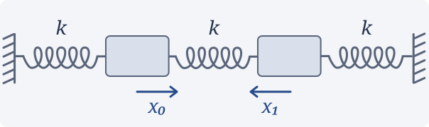

# The minimum of the coupled spring potential

The coupled spring potential $U(x_0,x_1)=x_0^2+x_0x_1+x_1^2$ has a unique
global minimum at the origin. To see why, think of two masses joined by
springs. Moving either mass stores energy in its wall spring. In
PhyslibAlpha, Bjørn Kjos-Hanssen proves a local minimum with a general
second-derivative test. The spring calculation also supplies the uniform
Hessian bound that drives that test.

## 1. Where the squares come from

Take two masses on a line between fixed walls. A spring connects each mass
to its wall, and a third connects the masses. All three ideal springs have
stiffness $k>0$ and are at their natural lengths at the reference positions.
Measure $x_0$ and $x_1$ from those positions, with each positive direction
pointing inward.

Moving the left mass inward by $x_0$ lengthens its wall spring by $x_0$.
The right wall spring lengthens by $x_1$. Both inward motions shorten the
middle spring, so its change in length is $-(x_0+x_1)$. Each spring stores
$\tfrac12k$ times its squared change in length. Their total is $kU(x)$, where

$$U(x)=\tfrac12\left(x_0^2+x_1^2+(x_0+x_1)^2\right).$$

For displacements in metres, $U$ has units of square metres and $kU$ is
in joules. Multiplication by $k>0$ preserves minima. The wall springs alone
give $U(x)\ge\tfrac12\lVert x\rVert^2$, so the origin is the only place
where all the stored energy can vanish.

**Supplementary result.** For every nonzero $x\in\mathbb R^2$, $U(x)>U(0)$.
Both sides are zero at $x=0$. A separate Lean proof written for this page
starts by completing the square.

$$U(x)=\left(x_0+\tfrac12x_1\right)^2+\tfrac34x_1^2.$$

If the sum is zero, the second term forces $x_1=0$. The first then forces
$x_0=0$. The three-square form identifies the spring that stores energy.
The two-square form rules out equality one coordinate at a time.

## 2. What Physlib proves

**Physlib theorem.** The coupled spring potential $U$ has a local minimum
at the origin. In symbols, $U(0)\le U(x)$ for all $x$ in some neighbourhood
of $0$.

Kjos-Hanssen applies the following test from the companion Lean file.
Let $f$ be real-valued on a finite-dimensional real inner product space.
If $f$ is analytic at $a$, its gradient vanishes at $a$, and
$D^2f(a)[h,h]>0$ for every $h\ne0$, then $f$ has a local minimum at $a$.

The hypotheses can all be read off from $U$. It is a polynomial, so it is
analytic at every point. Expanding $U(x+h)$ gives a linear term in $h$ and
the remainder $U(h)$. The bound $0\le U(h)\le\tfrac32\lVert h\rVert^2$
follows from the three squares and $(h_0+h_1)^2\le 2\lVert h\rVert^2$.
Thus $U(h)/\lVert h\rVert$ tends to zero as $h$ tends to zero through
nonzero vectors. The linear term is the derivative.

$$DU(x)[h]=(2x_0+x_1)h_0+(x_0+2x_1)h_1.$$

Both coefficients vanish at $x=0$, so the gradient at the origin is zero.
The coefficients depend linearly on $x$. Differentiating them gives
the same Hessian matrix at every point.

$$K=\begin{pmatrix}2&1\\1&2\end{pmatrix}.$$

To test positive definiteness, give the bilinear second derivative the
same displacement in both slots. This recovers twice the spring quadratic.

$$h^{T}Kh=2U(h)=h_0^2+h_1^2+(h_0+h_1)^2.$$

The Hessian at the origin is positive definite. In fact it gives the
uniform bound $h^{T}Kh\ge\lVert h\rVert^2$. The last square
vanishes when $h_0=-h_1$, so the bound is sharp.

## 3. Why the test is useful

The general test needs a lower bound that works in every direction near
$a$. Lean packages $Q(h)=D^2f(a)[h,h]$ as a quadratic map, so it can use
the same lower-bound lemma for any positive-definite $Q$ of this form.
The map scales by the square of a scalar, and the cross term
$Q(h+v)-Q(h)-Q(v)$ is bilinear. On the compact unit sphere, the continuous map
$Q$ attains a positive minimum $C$. Scaling gives $Q(h)\ge C\lVert h\rVert^2$.
The zero-dimensional case has only the point $a$.

At a critical point the Taylor expansion reads
$f(a+h)-f(a)=\tfrac12Q(h)+R(h)$. The power-series lemma gives
$R(h)=o(\lVert h\rVert^2)$. For any $\epsilon>0$,
$|R(h)|\le\epsilon\lVert h\rVert^2$ throughout some neighbourhood of
$0$. Lean's `nhds` denotes the neighbourhood filter. The little-o
hypothesis with that filter lets the proof choose the neighbourhood
after choosing $\epsilon$.

With $\epsilon=C/2$, the error can cancel at most the quadratic
lower bound. In that neighbourhood $f(a+h)\ge f(a)$, as required by
Lean's `IsLocalMin`. The same estimate with $\epsilon=C/4$ gives
a strict inequality for nonzero $h$ in a possibly smaller neighbourhood.

For $U$ the Taylor error is zero. Now add a cubic and set
$W(x)=U(x)+x_0^3$. At the origin the gradient and Hessian are unchanged,
and the Taylor error is the cubic itself. If $|x_0|<\tfrac14$, then
$x_0^3\ge-\tfrac14x_0^2$, so
$W(x)\ge\left(x_1+\tfrac12x_0\right)^2+\tfrac12x_0^2$, which is positive unless $x=0$.
The origin is still a strict local minimum, even though
$W(-2,0)=-4<W(0)$. A supplementary Lean proof checks the local minimum and
the value at $(-2,0)$. Near the origin the quadratic terms are larger than the
cubic, and far from it they are not, which is why the test can only give a
local conclusion.

### The smoothness hypothesis in Lean

Physlib's little-o lemma takes `ContDiffAt ℝ ⊤ f a`, smoothness of all
orders at $a$, in addition to the Taylor remainder hypothesis. Its proof
obtains a lower bound twice. The second route uses smoothness to show the
second derivative is symmetric and identify its bilinear representation
with the one recovered from the quadratic map. It shadows the constant
from the first route, which already gives the same kind of bound on the
diagonal. Once the Taylor estimate is given, the first bound suffices.
A supplementary Lean proof checks the little-o argument with that
smoothness hypothesis removed. In ordinary calculus a twice continuously
differentiable function also has the required Taylor remainder. The
Physlib test used here takes analyticity at the point.

## 4. What the potential says about motion

The spring interpretation in §1 supplies the forces. In the inward
coordinates they are $-kKx$. For instance, move the left mass inward by
$d>0$ and leave the right one at its reference position. The compressed
middle spring pushes the right mass toward its wall, giving force $-kd$
in its own positive direction.

To obtain motion, also specify the masses and the equations they obey.
With equal masses $m>0$, Newton's law and no damping give
$m\ddot x=-kKx$. Two displacement patterns stay in their own directions
because $K(1,-1)^{T}=(1,-1)^{T}$ and
$K(1,1)^{T}=3(1,1)^{T}$. Their angular frequencies are
$\omega_-=\sqrt{k/m}$ and $\omega_+=\sqrt{3k/m}$, respectively.
In the first pattern both masses move in the same physical direction
and the middle spring keeps its length. In the second they move
toward or away from each other, so the middle spring adds a restoring force.

Any initial displacement and velocity can be resolved along these two
directions. If only the left mass is displaced by $d$ and both masses are
released from rest, $(d,0)=\tfrac d2(1,-1)+\tfrac d2(1,1)$.
In particular,

$$x_1(t)=\tfrac d2\left(\cos(\omega_+t)-\cos(\omega_-t)\right).$$

The two contributions cancel at release and then evolve at different
rates. Their difference gives the motion of the mass that started at rest
at its reference position.

The same potential with unequal positive masses gives the same
equilibrium and a different frequency problem. For a diagonal mass matrix
$M$, the mode equation is $kKv=\omega^2Mv$. This dependence on $M$ is why
an energy minimum on its own gives no oscillation frequency.

For the undamped model, dot the equation of motion with $\dot x$ to see
that $\tfrac12m\lVert\dot x\rVert^2+kU(x)$ is constant. This energy bounds
$\tfrac12m\lVert\dot x\rVert^2+\tfrac12k\lVert x\rVert^2$ from above, so
small initial displacements **and** velocities stay small. The ideal
equations extend to all of $\mathbb R^2$. The physical model applies
while the masses stay between their walls in their original order and
the springs obey Hooke's law.

## Sources and review

- Bjørn Kjos-Hanssen, [Coupled spring potential][physlib-u] and
  [Second-derivative test][physlib-test], PhyslibAlpha at commit `be0a9ee`.
- Matthew D. Schwartz, [From Oscillators to Waves][schwartz], Harvard
  Physics 15c, §1. See also MIT OpenCourseWare,
  [Coupled Oscillators, Normal Modes][mit], for the superposition of modes.
- Schematic adapted from Jim.belk’s [Coupled Harmonic Oscillator k][figure],
  with inward displacement arrows and equal-stiffness labels.
  [CC BY-SA 3.0][figure-license].
- [Comparator receipt][comparator] for the original local-minimum theorem.
  Comparator accepted the Physlib proof against a challenge importing only
  Mathlib and rejected a control that asked for a local maximum.

AI agents wrote this companion under Will Cook’s direction. Lean checked
the two original modules and the supplementary proofs. A test in the
repository recomputes each identity, bound, frequency and sign stated here in
exact arithmetic and fails if the prose states a different one. It does not
judge the physical model. The prose, the passage links and the mechanics model
await independent expert review.

[physlib-u]: https://github.com/leanprover-community/physlib/blob/be0a9eef7dac78da524bfbde91c812340b194610/PhyslibAlpha/ClassicalMechanics/CoupledSpringPotential.lean
[physlib-test]: https://github.com/leanprover-community/physlib/blob/be0a9eef7dac78da524bfbde91c812340b194610/PhyslibAlpha/Mathematics/PartialDerivativeTest.lean
[schwartz]: https://schwartz.scholars.harvard.edu/sites/g/files/omnuum7046/files/schwartz/files/lecture4-oscillators-to-waves.pdf
[mit]: https://ocw.mit.edu/courses/8-03sc-physics-iii-vibrations-and-waves-fall-2016/pages/part-i-mechanical-vibrations-and-waves/lecture-4/
[figure]: https://commons.wikimedia.org/w/index.php?title=File:Coupled_Harmonic_Oscillator_k.svg&oldid=870225002
[figure-license]: https://creativecommons.org/licenses/by-sa/3.0/
[comparator]: https://github.com/wcook04/proof-reader/tree/f5f5e6f81251f766b0a705d46960e47e8b8a8962/papers/coupled-spring/comparator
